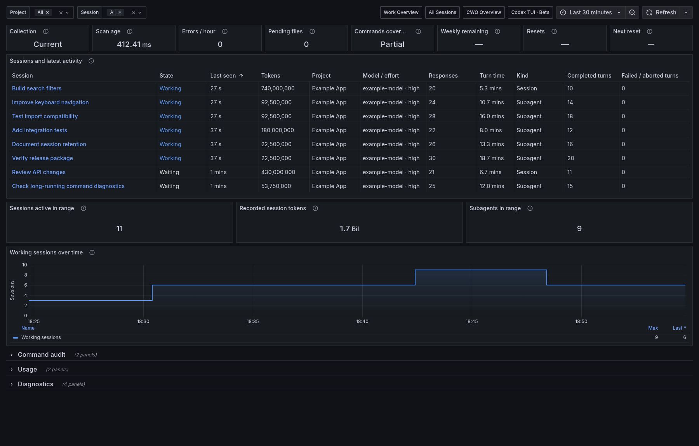

# All Sessions



*Example data. No personal sessions are shown.*

All Sessions pairs a session inventory with activity and recorded token totals.

## Import

Start the collector with [Quick Start](../getting-started.mdx). From the checkout root:

<!-- render-stable -->
```bash
export TRACEONAUT_DATA_DIR="$HOME/.local/share/traceonaut"
python3 scripts/render_codex_sessions_dashboard.py \
  --template examples/observability/codex-all-sessions.json \
  --snapshot-file "$TRACEONAUT_DATA_DIR/sessions.json" \
  --output "$TRACEONAUT_DATA_DIR/all-sessions.json"
```

Import `all-sessions.json` in Grafana and select your Prometheus datasource.

## Use the Dashboard

Select **Project**, **Session** and a time range. The default range is 30 minutes and refresh is 30 seconds. Choose **All** in the Session selector to include all matching sessions. Subagents appear as their own sessions.

[Reading the Values](reading-values.md) explains history totals, activity states and missing values. [Automatic Name Updates](../operations/automatic-name-updates.md) explains selector refreshes.

The session table combines the latest selected model and effort in **Model / effort**.
**Completed turns**, **Failed / aborted turns** and **Turn time** cover the session's recorded history. Expand a cell to inspect a long name.
The collapsed **Diagnostics** section holds **Usage source** and **Runtime reported** for checking token coverage.

The status strip leads directly into the inventory. **Usage** contains ranked comparisons; the working-sessions chart shows activity over time. The default refresh is 30 seconds.

## Command Audit

Expand **Command audit**, immediately before **Usage**, to see two tables:

- **Command history**: completion time, session, project, sanitized command, working directory, outcome, exit code and duration.
- **Network command history**: curl method, payload source, literal file path, upload option, source IP and requested endpoint.

Both tables use the Project, Session and time-range selectors. Time filtering uses each command's completion time. New records appear on normal dashboard refresh.

To include ordinary Codex sessions, add `--command-history --command-history-scope all` to your existing collector command and restart it. The default `cwo` scope includes only CWO-associated sessions. Command history must be enabled for these tables to contain data.


The file path identifies what curl was asked to send. Credentials and payload contents are omitted; source IP appears only when recorded. See [command-history fields and setup](cwo.md#commands-and-history), [privacy](../reference/data-sources-and-privacy.md#command-history) and [retention limits](../reference/retention-and-limits.md#shell-commands).
