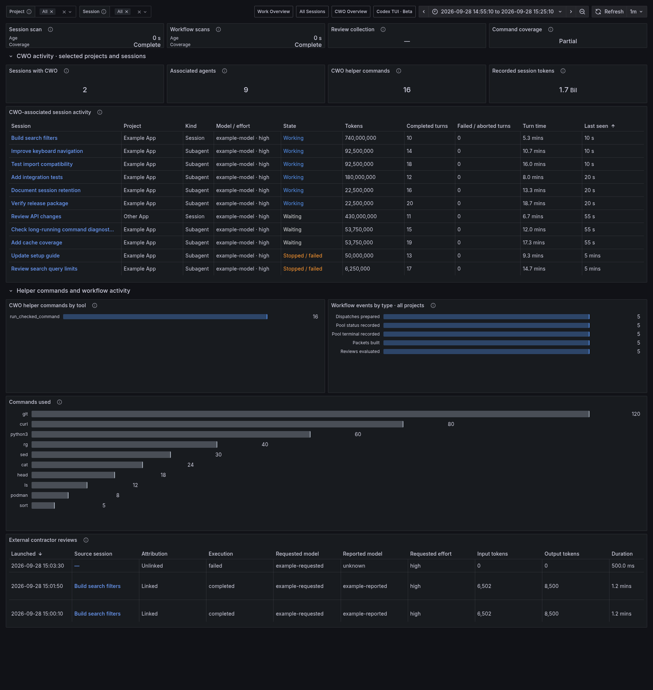
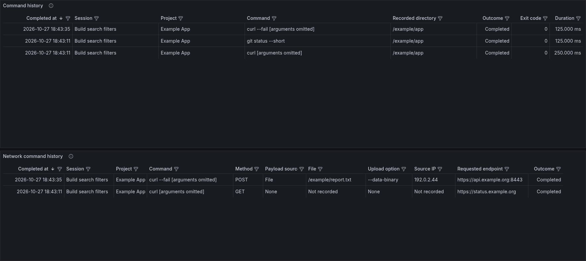

# CWO Overview



*Synthetic data in the current dashboard layout. Counts depend on enabled sources and the selected time range.*

CWO Overview shows Codex sessions and subagents that use CWO: their tokens, model/effort, completed turns, failed / aborted turns and turn time. Workflow audits and optional custom review-adapter results provide additional detail. Start with `--cwo-sessions` in [CWO Integration](../integrations/cwo.md#collect-cwo-sessions).

## Import

Import [cwo-overview.json](../../examples/observability/cwo-overview.json) and select your Prometheus datasource.

For readable session names, use the existing private session snapshot:

<!-- render-cwo -->
```bash
TRACEONAUT_DATA_DIR="$HOME/.local/share/traceonaut"
CWO_DASHBOARD_DIR="$HOME/.local/share/traceonaut/dashboards"
install -d -m 700 "$CWO_DASHBOARD_DIR"
python3 scripts/render_observability_dashboard.py \
  --template examples/observability/cwo-overview.json \
  --session-snapshot-file "$TRACEONAUT_DATA_DIR/sessions.json" \
  --output "$CWO_DASHBOARD_DIR/cwo-overview.json"
```

Import the generated file. The rendered selectors use names from the snapshot; missing names have explicit fallbacks. See [Automatic Name Updates](../operations/automatic-name-updates.md) for watcher/provisioning use.

## Use the Dashboard

The main overview shows CWO-associated sessions, native agents, recorded session tokens and helper commands. Choose **Last 1 hour** to see sessions with activity and helper invocations in that hour. The session table appears directly below the headline values.

Use **Project** and **Session** to filter the headline counts, session table, command names, helper commands and linked contractor reviews. Both allow multiple selections; **All** clears that filter. A Session selection matches those individual sessions or subagents. Project and Session selections apply together.

The rendered dropdowns use names from the exported session snapshot. Collection health and **Workflow events by type · all projects** remain profile-wide because their records have no project/session identity. Reviews with Unlinked, Pending or Ambiguous attribution appear when both dropdowns are **All**.

**Recorded session tokens** covers the selected sessions' whole recorded history, including work outside CWO. It is separate from tokens consumed during the selected range. Missing values display a dash; known empty counts display zero.

The top strip reports session collection, workflow-source health, review evidence gaps and command coverage. **Partial** means the configured sources have incomplete coverage. Review gaps retain the known invocation row while unavailable usage stays blank. The default range is 30 days and refresh is one minute; choose a shorter range, such as **Last 1 hour**, to focus recent activity.

Configure [CWO session collection](../integrations/cwo.md#collect-cwo-sessions) and [workflow event collection](../integrations/cwo.md#collect-workflow-activity) in the CWO Integration guide. Optional review rows require the [custom review adapter](../integrations/custom-review-adapter.md).

### Sessions and Helper Commands

This section follows the selected projects and sessions. Association comes from a CWO skill block, a supported helper invocation, or an associated parent session.

| Column | Meaning |
| --- | --- |
| Session, Project, Kind | The session or subagent and its project. |
| Model / effort | Latest selected Codex settings. |
| State, Last seen | Latest recorded activity and its age at the selected range end. |
| Tokens | Recorded tokens for the whole session. |
| Completed turns, Failed / aborted turns | Recorded completed and failed or aborted turns across the session. A completed turn can be one step in a larger assignment. |
| Turn time | Sum of reported turn durations. Waiting between turns and other unreported time are excluded. |

The time picker selects sessions active in that range. Their token and turn totals cover recorded session history. A subagent session has its own measurements; a session reused for several assignments combines their measurements.

**CWO helper commands** and **CWO helper commands by tool** count supported invocations in completed Codex command records within the selected interval, including failed attempts. Compound commands retain an unknown helper outcome because the shell result also covers subsequent commands.

### Commands and History

**Command coverage** shows Complete, Partial, Stale or Not collected. Missing session files, unsupported shell syntax or collection limits make coverage Partial while available history remains visible. [Retention and Limits](../reference/retention-and-limits.md#shell-commands) explains historical views.

**Command history** adds a table with completion time, session, project, a sanitized command description, recorded working directory, outcome, exit code and duration. It retains the latest 1,000 invocations within 30 days. Examples include `git push origin feature`, `tail -n 100 app.log` and `cat config.yaml`.

Command history defaults to CWO-associated sessions. `--command-history-scope all` includes ordinary Codex sessions in the configured profile's current session export selection, including sessions using a local vLLM provider. It does not collect commands from other applications or capture network packets. The dashboard's session, token, agent and helper panels remain CWO-associated.

The tables use the dashboard's existing Prometheus datasource. With command history enabled, the Python exporter publishes sanitized descriptions as metadata labels. New commands appear after collection, scraping and normal dashboard refresh; a page reload is not required.

**Network command history** shows curl commands and their requested HTTP(S) endpoints. Endpoints contain the scheme, host and port. URL credentials, paths, query strings and fragments are omitted. The exporter includes at most 1,000 network rows, with up to eight endpoints per invocation. **Source IP** shows the local socket address only when curl saved a supported connection report; otherwise it shows **Not recorded**. This address can differ from the public IP after NAT. Proxies and redirects can change the destination actually reached.

Upload-audit fields describe the recorded curl request, not proof of delivery:

| Field | Meaning |
| --- | --- |
| Method | Recognized requested HTTP method, or Unknown. |
| Payload source | None, File, Inline, Stdin, Mixed or Unknown, based on supported curl options. |
| File | Up to four literal file paths, bounded to 768 characters together. Dynamic paths remain unknown. File contents and sizes are not read. |
| Upload option | Canonical option names without inline payload values, credentials or configuration values. |

The outcome, exit code and duration describe the whole command invocation, not an HTTP response or a confirmed upload. A file path records what curl was asked to send; it does not establish that the file existed or reached the destination.



Descriptions omit credential options and values, commit messages, unknown arguments and embedded programs. Permitted paths, including upload file paths, remote names, branch names and recorded network addresses become Prometheus labels. Review [command-history privacy](../reference/data-sources-and-privacy.md#command-history) before enabling it.

The result belongs to the complete shell invocation. For `git status && git push`, the table has one row with one exit code and duration. **Recorded directory** comes from that invocation's record; a subsequent `cd` or `git -C` can select another directory. Missing fields show **Not recorded**.

#### Enable Live Command Tables

Add `--command-history` to the existing collector alongside `--cwo-sessions` for the default CWO scope. `--cwo-command-history` remains an equivalent alias. For a Codex collector configured through [Quick Start](../getting-started.mdx), stop the existing process and run:

```bash
python3 scripts/collect_sessions.py \
  --codex-home "$TRACEONAUT_CODEX_HOME" \
  --session-state-dir "$TRACEONAUT_DATA_DIR/session-state" \
  --snapshot-file "$TRACEONAUT_DATA_DIR/sessions.json" \
  --credential-file "$TRACEONAUT_METRICS_CREDENTIAL" \
  --host "$TRACEONAUT_LISTEN_ADDRESS" --port 9464 \
  --cwo-sessions --command-history
```

To include ordinary Codex sessions, use `--command-history --command-history-scope all`. This scope requires Codex collection but not `--cwo-sessions`; retain `--cwo-sessions` if you also want the CWO-associated panels. The default `--command-history-scope cwo` requires `--cwo-sessions`.

Keep any Bob, account and review options from your existing command. For a managed service, add the flag to its existing start command. Use the ordinary rendering command above and select the existing Prometheus datasource when importing the dashboard. Command rows then update on its normal refresh interval.

To disable future history export, remove `--command-history` (or its alias) and any `--command-history-scope all` option, then restart collection. Previously scraped descriptions, paths and network addresses remain in Prometheus until its retention policy removes them. Saved exports retain their data.

### Workflow Activity

**Workflow events by type** counts events whose original timestamps fall inside the selected range, across configured audit logs. It can be empty while session and helper activity is present: only operations that write audit events appear in that chart.

**External contractor reviews** shows requested and reported model, effort, tokens and duration for recorded invocations. **Execution** describes CLI completion or failure; **Evaluation** shows the audit verdict and any pending peer review. **Saved record** identifies unavailable evidence. Attempts remain visible when their launch dates fall within the selected range, including results recovered later. With [session attribution](../integrations/custom-review-adapter.md#link-reviews-to-codex-sessions) enabled, **Source session** links to the launcher. Unlinked, Pending and Ambiguous rows appear when both filters are **All**.

[Retention and Limits](../reference/retention-and-limits.md) explains source history and exports. [Reading the Values](reading-values.md) explains token totals, partial coverage and missing values.
